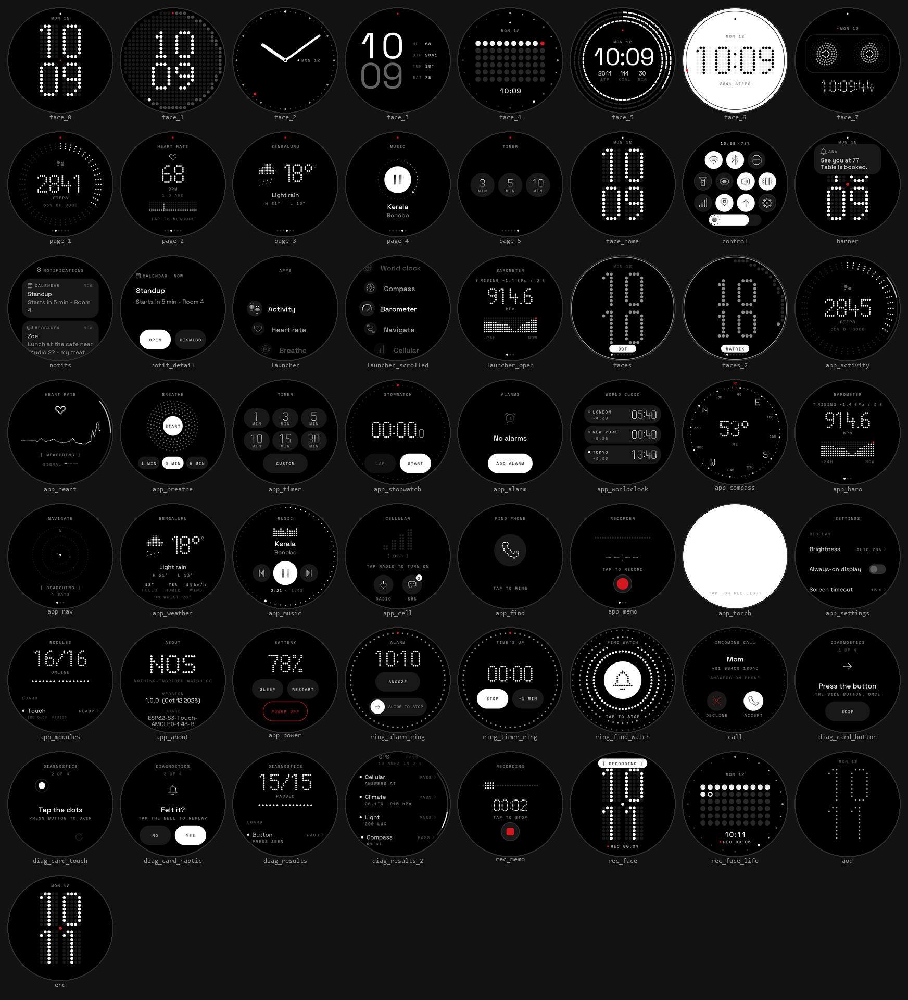
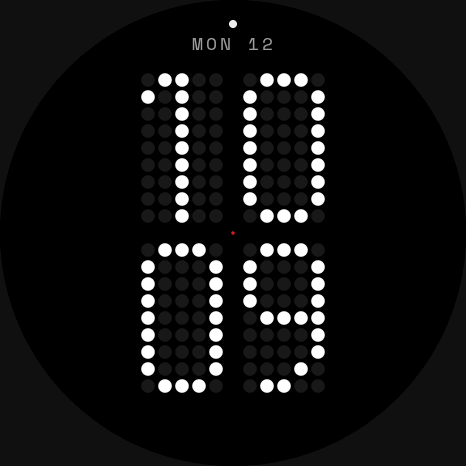
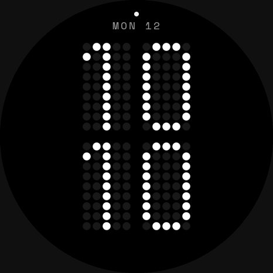
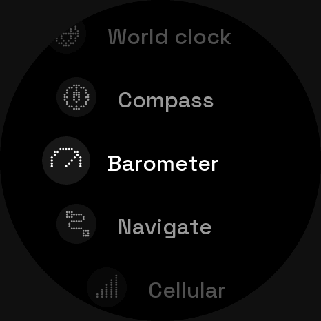
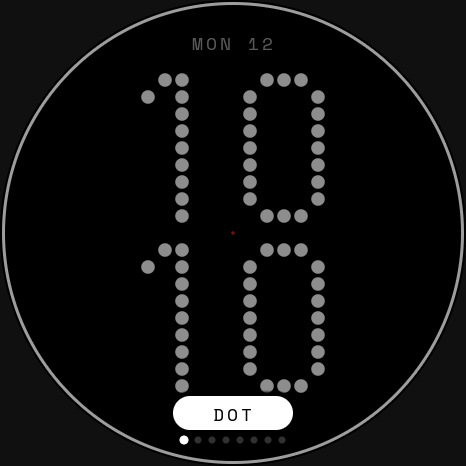
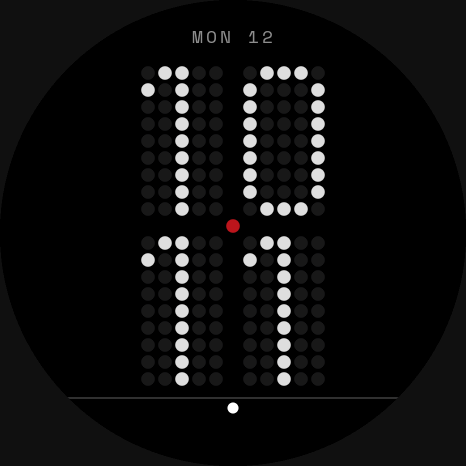
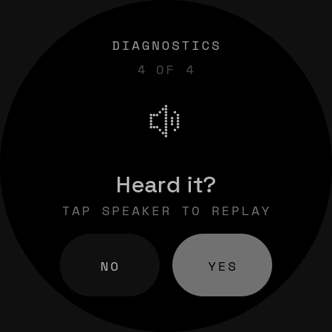
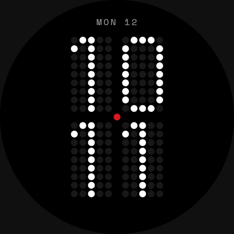

# NOS — a Nothing-inspired OS for the Waveshare 1.43-B

Branch `nothing-os`. A from-scratch watch OS for the ESP32-S3-Touch-AMOLED-1.43-B
(466x466 round AMOLED, touch, one side button) and the strap modules in
`docs/strap_layout.html`: true black, white ink, dot-matrix numerals, caps mono
labels, one red at most, and 30 fps on the real board.

| Pager | Control centre | Notifications | Launcher + iris |
|---|---|---|---|
|  |  |  |  |
| **Face picker** | **Incoming call** | **Diagnostics** | **Double press: last app** |
|  |  |  |  |

## What's in it

- **8 faces:** DOT, MATRIX, GLYPH, SPLIT, LIFE, SEGMENT, INVERTED, TAPE. Each has an
  always-on version and a 6-frame wake. The face picker opens in place.
- **Shell:**
  - Home pager with widgets (activity, heart, weather, music, timer).
  - Control centre with tiles and a brightness pill.
  - Notifications with a banner, a list and a detail view.
  - Launcher: an iris grows from the tapped icon, and a double press reopens the last app.
  - Power sheet, boot animation, toasts, and a REC chip while recording.
- **Health and time:** Activity, Heart rate, Breathe, Timer, Stopwatch, Alarms (ring and
  snooze), World clock.
- **Outdoor:** Compass, Barometer, Navigate (GPS track), Weather.
- **Connect:** Music, Cellular, Find phone, Recorder, Torch, Call. The phone link is
  Gadgetbridge, with the watch appearing as a Bangle.js.
- **System:** Settings, Modules, About, Power, and **Diagnostics**. Diagnostics is a
  guided test of every board part and strap module. Sensors are checked against real
  thresholds and actuators are confirmed by you. Results are PASS, FAIL with a reason,
  NOT CONNECTED or SKIPPED, and every result is logged over USB as `DIAG ...`.

Every module-dependent screen has a "not connected" state with the same wording
everywhere. Losing or regaining the phone or a module fades between states instead of
cutting.

## Performance, measured on the board

On the 1.43-B (COM3) at `3941ba4`, every case had **0 late frames** (budget 33.3 ms):

| Bench | What | Worst frame |
|---|---|---|
| `gestures.py` | pager, control centre, notifications, banner, picker, launcher, settings, back, world clock, faces | 32.4 ms |
| `survey.py` | every app opened and closed (43 rows) | 29.3 ms |
| `facecost2.py` | each of the 8 faces: full repaint, picker open, always-on wake | 32.8 ms |
| `slides.py` | picker slides between every pair of faces, both ways | 31.5 ms |
| `bootjank.py` | 20 s of paging while Wi-Fi connects and weather fetches | 25.3 ms |

The output is in `build/nos-bench/final_board.txt` and `final_survey.txt`. What it
took is in [the device lessons](#device-lessons).

## Build, flash, simulate

- **Firmware:** `.\build\build_lead.ps1 -Port COM3` builds the committed HEAD in a clean
  worktree (`A:\makerspace\nos-lead`) and flashes it. ESP-IDF 5.5.
- **Simulator:** `.\sim\nos_build.ps1 -Run` builds the simulator and opens a window.
  For headless scripts, shots, films, GIFs and `--damagecheck`, see
  [NOS_SIM.md](NOS_SIM.md). `build/nos/showcase/show.txt` renders every screen in
  this page.
- **Bench over USB:** the scripts in `build/nos-bench/` drive the watch through serial
  commands (`tap`, `swipe`, `btn`, `open NAME`, `face N`, `full 1`, `aod 1`,
  `trace N`, `info`).

## How it was made

The spec is [NOS_DESIGN.md](NOS_DESIGN.md): visual rules, motion rules, and §8
standards for words, sizes, states and absent pages. Research is in
`docs/research/` (the Nothing design language, and ZSWatch for OS ideas and the
Gadgetbridge protocol).

Teams of agents owned areas of the OS (shell, faces, health and time, outdoor,
connect, settings) and the lead owned the engine. Five rounds of independent design
critics reviewed every screen frame by frame against the spec. Their critiques are
in [docs/polish/](polish/) (`*_r1` to `*_r5`, plus `diag_r1`). The loop ran until no
critic could show an issue above P3 ("nit").

## Device lessons

- The sim's cost model prices pixels, not CPU time in draw code. Screens draw once
  per 16-row stripe, 30 times a frame, so per-item work costs 10 ms or more on the
  watch.
  - Fix: dot lists are evaluated once per frame.
  - Fix: masks, fonts and sprites are pre-built instead of on first use. First-use
    builds had made 50–500 ms frames.
- Internal SRAM is scarce: display DMA, I2S and TLS all need it. Wi-Fi's static TX
  buffers and IRAM-optimised code were moved out of it, and free internal SRAM went
  from 14 KB to 47 KB.
- Never dissolve between near-identical screens; animate what changes instead. For
  example, the face picker opens in place over the live face.
- Programmatic motion is tweened (opens) or constant speed (closes). Springs are used
  only when a finger hands over its velocity, because a spring's settle is several
  frames of 1–7 px creep.
