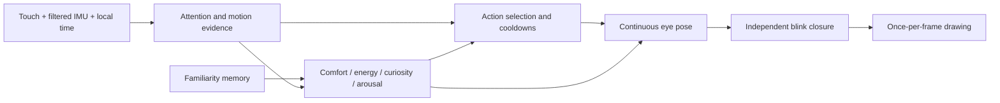

# Pip — an attentive little eye character

This records the initial expression prototype. The expanded persistent pet is
documented in [Living with Pip](PIP_LIFE.md), with the full study and revised
plan in [research/PET_IMPLEMENTATION_PLAN.md](research/PET_IMPLEMENTATION_PLAN.md).

Pip is watch face **1**, selected with `face 1`. The design keeps the original
two glowing eyes and small clock, and builds personality through attention,
timing, asymmetry and continuity. It responds to the FT3168 touch controller
and QMI8658 accelerometer/gyro. Its reactions are silent on this board.

## Fleet review and deployment plan

Three parallel reviews covered expression, interaction/state handling, and
panel performance. The resulting plan is:

1. Separate attention, emotion, action and visual pose. Give fast gaze shifts
   different timing from eyelids and body-of-the-eye movement.
2. Stage reactions with anticipation, a readable response and recovery.
   Keep a continuous pose when an interaction interrupts an idle activity.
3. Preserve petting gestures through release, add explicit return greetings,
   and gate motion/sleep decisions with evidence and cooldowns.
4. Make comfort, energy, curiosity, arousal and familiarity visible. Test
   state logic separately from the rendering and OS gesture integration.
5. Inspect every expression, build, flash and test on the connected watch.
   Keep QSPI at its actual 40 MHz and reduce drawing overhead.

The expression review drew on Disney Research's layered attention, habituation
and saccade work in [Realistic and Interactive Robot Gaze](https://la.disneyresearch.com/publication/realistic-and-interactive-robot-gaze/),
the real-time animation composition in [Ribeiro and Paiva](https://arxiv.org/abs/1904.02898),
and Anki's [Cozmo animation pipeline presentation](https://www.gdcvault.com/play/1024221/Cozmo-Animation-Pipeline-for-a).
The timings below are design choices for this watch, to be tuned with physical feedback.

## What to try

| Input | Pip's response |
|---|---|
| Tap an eye | A small local recoil, then a happy acknowledgement |
| Double tap | A short ball game; the eyes follow the ball |
| Move a finger while pressed | Pip looks toward the finger |
| Stroke across the eyes | Happy crescent eyes; continued strokes sustain the animation |
| Hold a finger on Pip | A relaxed, affectionate expression |
| Gently tilt the watch | Gaze and eye height respond to filtered gravity; tilt steers the ball during play |
| Gently rock back and forth | Settles into a soothing sway after repeated direction changes |
| Sudden movement | Brief startled reaction, then inspection and recovery |
| Repeated rapid motion | Dizziness that settles into a stretch; cooldown prevents repeated interruptions |
| Rest face-down | Drowsiness, then sleep after orientation and stillness persist |
| Pick up from that rest | Wake, asymmetric opening, stretch |
| Return after time elsewhere | A short greeting instead of immediately falling asleep |
| Leave Pip alone | Small glances, blinks, peeks, winks, stretches and occasional self-directed play |

Stroke in the central eye area. Swipe **below the eyes** to change watch face.
Edge swipes keep opening system menus; BOOT still goes home. The touch test
page remains available with `diag touch`.

## Behavior layers



Gaze prioritizes a pressed finger, then active play, tilt and idle curiosity.
Reflex startle/dizziness can briefly take priority to keep the reaction legible.
Curiosity affects how widely and often Pip looks around. Arousal opens the
eyes slightly and sharpens gaze changes, then decays. Comfort softens petting.
Energy changes pacing and glow; low battery has only a small influence because
this board's battery percentage is an approximation.

The 16 actions are `idle`, `curious`, `happy`, `petted`, `boop`, `startled`,
`dizzy`, `rocked`, `sleepy`, `asleep`, `wake`, `play`, `bored`, `stretch`,
`wink`, and `peek`. Most reactions last 0.85–3.6 seconds; play lasts 8.5 seconds.
Important sequences include boop → happy, startle → curious, dizzy → stretch,
and wake → stretch. Petting renews its expiry without restarting its animation.

Blinks close in about 45 ms, hold for 25 ms, and reopen over roughly 100 ms,
with a little extra time at low energy. They are applied after pose smoothing
so they actually close even at 20 fps. Curiosity and waking use different lids
and slight height differences between the eyes.

## Motion and memory

Gravity is low-pass filtered. Transient acceleration and gyro speed supply
motion evidence; small stationary gyro bias is learned gradually. Rocking
requires direction reversals, not just a steady turn. Surprise and dizziness
have separate cooldowns. Invalid or missing IMU data leaves touch and idle
behavior working, and cannot cause false face-down sleep.

`pip center` sets the current steady pose as neutral for tilt/gaze. The default
screen-axis mapping uses the corrected B-board orientation; physical tilt
direction and the rocking thresholds still benefit from hands-on tuning.

Familiarity grows slowly through interaction, at most once per ten seconds.
It reduces the shyness of boops and permits more spontaneous play. It does not
decay when the watch is ignored. A validated versioned NVS blob stores it,
saved outside rendering at five-minute intervals or before explicit deep
sleep. `pip save` checkpoints it immediately. Sudden power loss can lose the
most recent unsaved interactions. There are no feeding, illness or punishment
mechanics.

Nighttime quiet (22:00–07:00) leads to drowsiness. Touch/pickup gives a 45-second
awake window. Pet sleep is an animation state, separate from device power
management. The existing 30-second dim/120-second display-off policy remains;
touch or BOOT wakes the display. IMU motion does not wake explicit deep sleep
or a fully off display in this version.

## Testing and USB iteration

```powershell
python tools/watchctl.py --port COM3 face 1
python tools/watchctl.py --port COM3 pip
python tools/watchctl.py --port COM3 pip center
python tools/watchctl.py --port COM3 pip demo happy
python tools/watchctl.py --port COM3 pip demo dizzy
python tools/watchctl.py --port COM3 pip live
python tools/watchctl.py --port COM3 pip save
```

`pip demo ACTION` starts that animation without fabricating sensor readings.
Natural inputs can still interrupt it. `pip live` returns to idle and real
inputs. Debug output reports state, emotional parameters, familiarity, IMU
validity and touch state. Demos do not award familiarity.

Run `tools/test.ps1` for deterministic model and board tests. Build the simulator
and run `sim.exe --pip-checks` for OS gesture integration, or
`sim.exe --pip-gallery` in a directory containing `pip_frames/` for a repeatable
expression gallery and animation frames. Hardware tests must distinguish USB
injected gestures from real fingers and movement.

## Display budget

QSPI is **40 MHz**. Requesting 50 MHz still divides to 40 MHz on the S3's
80 MHz SPI source; the next faster rate is 80 MHz. See the
[ESP-IDF divider](https://github.com/espressif/esp-idf/blob/v5.5.4/components/hal/esp32s3/include/hal/spi_ll.h#L783)
and [clock documentation](https://docs.espressif.com/projects/esp-idf/en/v5.5.4/esp32s3/api-reference/peripherals/spi_master.html#spi-clock-frequency).
The [Waveshare-linked SH8601Z datasheet](https://files.waveshare.com/wiki/common/SH8601Z0_V0.0.pdf)
specifies a 20 ns minimum quad-write period (50 MHz). The connected board's
0xff probe result still selects the CO5300 fallback, rather than positively
identifying SH8601Z.

A full frame takes at least 21.72 ms on the wire at 40 MHz QSPI, before drawing
and transaction costs. Pip uses geometric primitives, a cached clock, compact
dirty regions, and no animation-time allocations. Animation state advances
once per frame; render stripes see the same pose. Motion processing is constant
space and time. New microphone reactions, motion-based display wake, and more
elaborate learned preferences are later extensions, not claimed features.
