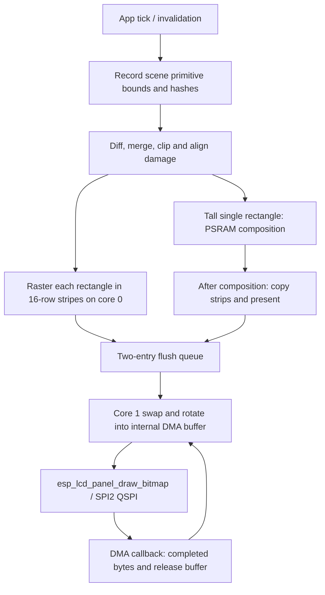

# Display optimization baseline — 2026-09-19

Workspace branch: `perf/display-optimization`. Original OS: `dc1999c`, tagged
`display-baseline-20260919`. Existing uncommitted instrumentation was preserved
in `build/display-optimization/starting-worktree.patch` and
`starting-untracked.zip` before this session's changes.

## Hardware and reproducibility

- Waveshare ESP32-S3-Touch-AMOLED-1.43-B; connected native USB Serial/JTAG on COM3,
  USB serial/MAC `28:84:85:b0:8b:30`. Exact PCB silkscreen revision unverified.
- ESP-IDF installation `A:/makerspace/esp-idf`, revision `897cf407` (5.5.4
  installation); Xtensa GCC 14.2.0, package `esp-14.2.0_20260121`.
- CPU 240 MHz, performance optimization (`-O2`), 1 kHz FreeRTOS tick.
- 16 MiB DIO flash at 80 MHz; 8 MiB octal PSRAM at 80 MHz.
- Task watchdog enabled, 5 seconds, both idle tasks checked; panic disabled.
- SPI2 QSPI: CS9, CLK10, D0..D3 GPIO11..14, reset21, enable42.
  Requested clock 40 MHz; divider-derived 40 MHz, not scope measured.
- TE is not routed according to the board pin map. No TE synchronization is
  enabled. Software pacing is not evidence of tear-free output.
- Two 14,912-byte internal render buffers and one 14,912-byte rotated DMA
  buffer (16 rows); a 434,312-byte PSRAM composition surface. Queue capacity 2,
  one DMA outstanding. Renderer core 0, flush task core 1.
- Custom retained damage renderer; **no LVGL and no current 70,000-pixel cap**.

Exact original binaries, sdkconfig, dependency lock, partition CSV, build,
flash, boot, test and three 60-second legacy app logs are preserved locally in
`build/display-perf-baseline/`. The factory/full-flash backup remains as
documented in [RECOVERY.md](RECOVERY.md). Normal updates write only the app
partition at `0x10000`, preserving NVS, storage and RTC settings.

## Controller evidence

The legacy firmware returned DA=`FF` and selected its existing CO5300 fallback
initialization (x gap 6). Instrumentation repeated register `04` (four raw
bytes), `DA`, `DB`, `DC` five times. **Every byte was FF**, with successful GPIO
API calls. This is failed/unverified electrical readback, not identification.
No new controller-specific initialization, RAM-write continuation scheme or
clock increase is justified by those reads. The existing working init table
and transport are retained. `perf display probe` exports cached boot evidence;
it does not reset the running panel. Dummy-cycle correctness and a harmless
post-init register read remain unverified.

## Display path



Entry points: `core/wos.c` (`wos_run_frame`, `render_rect`),
`firmware/main/main.c` (`stripe_flush`, `flush_task`, `frame_end`,
`on_stripe_done`). Vendor driver is the locked
`waveshare/esp_lcd_sh8601` component under `firmware/managed_components/`.

The current discontinuity is geometric: a single damage rectangle at least
233 rows tall takes the compose-then-present path. Scene traversal repeats for
each stripe of each rectangle. Therefore equal dirty-pixel counts can have
different render and wall times. There is no historical damage backlog: each
frame drains its buffers and final DMA before the next frame.

## Capture and interpretation

```powershell
python tools/display_perf.py --port COM3 --output build/display-apps.jsonl --command "perf display info" --command "perf display probe" --command "perf display app face0 60" --command "perf display app level 60" --command "perf display app breathe 60"
python tools/display_perf.py --port COM3 --output build/display-synthetic.jsonl --command "perf display sweep"
```

`fill N sram|generator|psram` and `rect W H N [source]` use complete frames;
choose enough frames for at least ten seconds. `sweep` exercises all three
sources at 4/8/16-row payloads at the existing clock. `status` shows counters;
`export` prints the latest four app traces. App trace `current` profiles the
current screen; other names are `face0`, `pip`, `level`, `breathe`, `stopwatch`.
App traces temporarily inhibit display sleep. Capture cleanup restores normal
sleep and returns home.

Completed payload bytes come from the DMA callback. Percentiles are conservative
histogram bucket upper bounds, not exact order statistics. `frame_work` excludes
intentional frame pacing; `completion_cadence` measures **stripe** completions,
not panel refresh or complete-frame cadence. App fps is present frames divided
by trace duration. Stage totals on different cores overlap and must not simply
be summed. Unmeasured values are null, including physical tearing and current.
Wi-Fi/BLE remain running; the captured device was retrying an unavailable Wi-Fi
network, not exercising successful Wi-Fi traffic or BLE streaming.

Transport implementation follows the single-owner and internal DMA-buffer
constraints in the [ESP-IDF 5.5.4 SPI guide](https://docs.espressif.com/projects/esp-idf/en/v5.5.4/esp32s3/api-reference/peripherals/spi_master.html).
