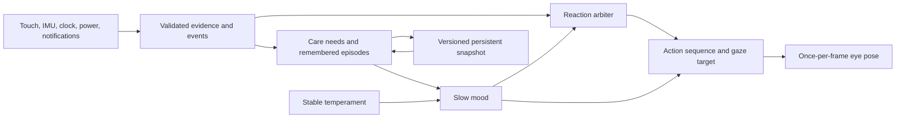

# Pip: Persistent Personality and Care Behavior

Pip should remain an expressive pair of glowing eyes, with a recognizable temperament and a life that continues between visits. The proposed implementation separates immediate reactions, everyday needs, longer moods, and remembered experiences. A tap can produce a delighted squint while an unresolved need still shapes the next idle expression. Charging, a walk, rest, and attention should produce different kinds of recovery.

The recommended design is a small deterministic care model with an event arbiter and a procedural eye renderer. It supports a grumpy Pip, including grumpiness after prolonged inattention or a missed charging request, while making the cause understandable and the relationship repairable. It runs locally on the ESP32-S3 and does not require language inference, audio, a camera, or an SD card.

This document distinguishes **published evidence**, **observed code behavior**, and **proposed design parameters**. Numerical rates and thresholds below are initial engineering choices for validation, not established psychological constants. The source audit reflects the repository inspected on September 13, 2026; later implementation can supersede individual observations.

## Requirements and Traceability

| ID | Required experience | Observable implementation | Acceptance evidence |
|---|---|---|---|
| R01 | Keep Pip as expressive eyes with a consistent personality | Stable eye identity; asymmetric lids, gaze, blink and timing variations; no body required | Expression contact sheet and transitions on the physical watch |
| R02 | Notice and greet a returning companion | Different reactions for a brief return, morning wake, and a longer absence; persistent familiarity affects warmth | Recorded resume scenarios, including reboot |
| R03 | Enjoy touch and petting | Immediate pointer attention, boop, sustained stroking, comforting hold, playful double tap | Raw-pointer and WOS gesture tests; physical touch alignment |
| R04 | Become grumpy when ignored | Slow social-need decline over awake time, persistent sulky mood, readable reason and recovery | Accelerated hours-long traces and a day of normal use |
| R05 | Care about timely charging | Observe a low-energy request, remember whether it was resolved, express concern and later grumpiness | Validated power traces; no invented charging events |
| R06 | Enjoy walks and exercise | Reward sustained qualifying activity, remember outings, show an after-walk mood | Stationary, walking, shaking and transport recordings |
| R07 | React to notifications and alarms | Brief orienting response to a new event, with batching and priority | More than eight arrivals; duplicates; alarm conflicts |
| R08 | Have a daily rhythm and energy | Local-time rest tendency, quiet nighttime behavior, battery-aware expression intensity | Night/day/timezone/unsynchronized-clock scenarios |
| R09 | Remain the same pet across interruptions | Versioned memory, care history, bounded offline advancement and reboot-safe recovery | Persistence, corruption, clock-jump and migration tests |
| R10 | Preserve the watch as a usable watch | Edge menus remain reachable; petting does not become an accidental tap or face switch | WOS integration tests and actual touch navigation |
| R11 | Explain and verify behavior | Debug output identifies dominant need, evidence quality, current event and reason | Reproducible scenario logs and controlled demo inputs |

## Published Evidence and Case Studies

### Kismet: Drives, Attention and Behavioral Coherence

Kismet's published architecture separates perception, attention, motivation, behavior selection and motor expression. The behavior layer arbitrates competing goals with attention to relevance, coherence and persistence. Its documented homeostatic model includes social interaction, stimulation and fatigue drives. These are architectural precedents for a character with its own continuing agenda, rather than a collection of unrelated animations. They do not establish optimal care rates or demonstrate that a smartwatch implementation will produce the same experience. [1: Kismet architecture](https://groups.csail.mit.edu/lbr/sociable/kismet.html), [2: homeostatic regulation](https://groups.csail.mit.edu/lbr/sociable/homeostatic-regulation.html).

**Design inference:** represent a few meaningful needs and make one behavior responsible for the current social moment. Allow an immediate reaction to interrupt an idle action, but preserve enough of a recovery sequence for the response to read as intentional.

### ALMA: Different Timescales for Emotion, Mood and Personality

Gebhard's ALMA model distinguishes short emotions, medium-term moods and longer-term personality. Appraisals produce affect, which downstream systems use to influence behavior. The paper's architecture is useful here; its full emotion vocabulary, Java implementation and human personality mappings are unnecessary for a small eye character. [3: ALMA paper](https://alma.dfki.de/papers/aamas05.pdf).

A follow-up study used textual questionnaires with 33 participants aged 18–38 to assess the plausibility of generated emotions and moods. It explicitly did not test their visualization through a character; emotions were rated more plausible than moods overall. That distinction matters: a reasonable state model is not evidence that its rendered face is readable. Pip needs both state-trace review and separate visual testing. [4: ALMA plausibility study](https://alma.dfki.de/papers/iva06.pdf).

**Design inference:** keep a persistent mood underneath a short expression, and evaluate the cause of a reaction independently from its animation. A petting response may be happy while the remaining low-energy condition still makes the subsequent idle face subdued.

### Relational Agents: Continuity Beyond the First Session

Bickmore and Picard evaluated a relational exercise agent with 101 participants asked to interact daily for a month. Relative to a comparable task-oriented agent, the relational version received higher liking, trust and respect ratings and a greater stated desire to continue. The study involved an embodied conversational exercise system, not silent eyes, so its results do not quantify a benefit for Pip. It supports investigating remembered interaction and repeated greetings as part of the experience, rather than relying only on novelty. [5: relational-agent study](https://www.researchgate.net/publication/220286280_Establishing_and_maintaining_long-term_human-computer_relationships).

**Design inference:** remember a few concrete things that can visibly change the next encounter: familiarity, recent care, the last completed outing, and an unresolved charging request. Avoid a memory system that accumulates numbers without affecting the face.

### Fish'n'Steps: Care Can Motivate and Can Also Discourage

Fish'n'Steps connected measured daily footsteps with an animated fish. Its fourteen-week study involved nineteen participants. The authors reported reduced enthusiasm after the initial weeks and cautioned against discouraging negative feedback when people were not meeting their expectations. This is a small exploratory study, not evidence that all negative expressions are harmful or that a particular reward rate improves health. [6: Fish'n'Steps original paper](https://www.researchgate.net/publication/221568603_Fish%27n%27Steps_Encouraging_Physical_Activity_with_an_Interactive_Computer_Game).

**Design inference:** retain grumpiness as requested, but give it an immediate route toward repair. A short sulk followed by tentative acceptance is more useful for this design than a pet that stays inaccessible until tomorrow. Walking should create a positive shared episode; missing an exercise quota should not be the primary reason Pip rejects interaction.

### Tamagotchi Uni: A Product Precedent for Persistent Care

Bandai's official manual distinguishes care/status information, happiness, personality and days together. It also documents a walk activity and tilt-controlled play. This establishes a shipped product precedent for combining a continuing pet with movement and daily activities; it is not a controlled evaluation of effectiveness. Pip can borrow the connection between care, continuity and play while keeping its own eyes-only presentation. [7: official Tamagotchi Uni manual](https://tamagotchi-official.com/manual/toy/uni/manual_03/Uni_WEB_IS_EN.pdf).

### Resulting Design Principles

The evidence supports a useful architecture and several testable ideas. It does not prescribe a universal simulated personality. For Pip, the proposed principles are: events have identifiable causes; needs change slowly; reactions begin promptly; recovery is visible; mood survives a short animation; and remembered experiences alter later behavior. The implementation should remain explainable enough to distinguish a deliberate sulk from a sensor or clock bug.

## Audit of the Existing Implementation

| Area | Observed state | Implication for the expanded pet |
|---|---|---|
| Behavior model | `core/pip.c` already provides sixteen actions, sensor filtering, touch reactions and time-based pose updates | Reuse the expressive model instead of replacing the renderer |
| Persistence | `pip_memory` stores magic, version, familiarity, visits and RNG seed | Needs, charging history, activity and elapsed-time anchors do not yet survive reboot |
| Visits | Initialization increments `visits`; `face_pip_service` can initialize at boot | This counts model initialization, not distinct meaningful visits |
| Service cadence | The face calls `pip_step` when drawn; `face_pip_service` mainly saves memory | Care and movement must be serviced independently of rendering |
| Battery | `hal_battery_percent()` maps the GPIO4 system rail linearly from 3.3–4.2 V; USB can lift the rail above battery voltage | It cannot prove actual charge percentage, charging current, or full charge |
| Battery inference | `core/battery.c` infers charging from voltage trends and uses fixed per-call smoothing coefficients | Rendering cadence changes the filter's effective time constant; do not use this unqualified state to assign care blame |
| Activity | `hal_step_count()` returns zero in the device HAL | Real walking rewards require a new motion classifier or a later validated pedometer |
| Notifications | `notif.c` holds eight items; `notif_count()` saturates; no device-side `notif_push` producer was found | Arrival needs an event sequence and a real transport path; count changes alone miss arrivals |
| Clock | The port restores the external PCF85063 clock and tracks validity in `board.c` | A valid UTC anchor is available, but not yet part of `pip_input` |
| Comments | `settings.h` still describes the board as having no hardware RTC | Update this stale explanation when integrating the new clock contract |
| Alarms | Alarm service produces a callout and audio hook; no Pip event is emitted | Add a typed alarm event at the actual firing point |
| Output hardware | No local speaker, microphone or haptic motor is available on this variant | Every essential reaction must be visible without sound |
| Regression coverage | Touch/resume, cooldown, motion, sleep, sustained petting, blink, wrap and pose bounds are tested | Extend these tests to hours, reboot and system events |

The battery limitation changes the design materially. Pip may look tired when a trustworthy battery-only voltage reading is low. It must not congratulate itself for a complete charge merely because USB raised the system rail to 5 V. A charging request that the software never observed also cannot become a recorded missed-care event.

## Competing Proposals

| Proposal | Strength | Main difficulty | Decision |
|---|---|---|---|
| A. Expand the existing reaction state machine | Fast to implement; every animation is easy to trigger | A state per combination becomes unwieldy; moods vanish when reactions end | Retain only for short action sequences |
| B. Full human affect framework | Extensive vocabulary and theoretical structure | Many dimensions cannot be expressed or validated on two eyes; unnecessary implementation cost | Use the timescale separation, not the full framework |
| C. Care meters plus weighted event arbitration | Persistent causes, bounded computation, clear tests; reuses current rendering | Requires explicit evidence quality, clock handling and tuning | **Recommended** |
| D. Language-model-directed personality | Flexible text narratives and future conversation | Current hardware has no audio input; inference is unnecessary for deterministic sensor reactions | Keep outside this implementation |

Proposal C combines a slow care simulation with the existing action model. It is deliberately smaller than a general social-agent framework: four care quantities, two mood coordinates, a few stable traits, a compact event queue and a short cause history.

## Revised Behavior Architecture

A background service consumes cached sensor data and advances care using elapsed time even when another app is open. The renderer reads a snapshot and updates only animation. An invisible Pip does not require a high frame rate. Clock and power evidence can be serviced at approximately one-second cadence; movement classification needs the board's independent sample stream or a suitable fixed-rate service.

### Persistent Needs and Temperament

All stored care values should use bounded integers, for example 0–1000, with explicit validation. Float calculations can remain convenient in the runtime model; do not persist arbitrary structure padding or unchecked floats as the storage format.

| Quantity | Timescale | Main changes | Visible consequence |
|---|---|---|---|
| Social satisfaction | Hours | Falls during awake absence; rises through actual greeting and care | Attention seeking, side glances, lonely or sulky idle |
| Stimulation | Hours | Falls during a quiet day; rises through play and qualifying outings | Curiosity, playful peeks, willingness to play |
| Rest reserve | Hours | Recovers during a rest interval; depletes slowly during the active day | Blink length, lid height, stretch and sleepy transitions |
| Comfort | Minutes to hours | Rises with stroking/holding; temporarily falls after rough motion | Relaxed squints versus guarded gaze |
| Valence | Minutes | Moves toward a weighted combination of needs and recent events | Overall positive, neutral or grumpy expression bias |
| Arousal | Seconds to minutes | Rises with novelty/motion; settles when quiet | Gaze speed, eye opening, reaction timing |
| Familiarity | Days | Increases through spaced meaningful episodes | Warmer greetings and more relaxed acceptance |
| Stable temperament | Lifetime | Seeded once; optionally changed by an explicit setting | Mischief, curiosity and sensitivity remain recognizable |

Charging is tracked as an episode with evidence, rather than becoming a second fake battery meter. Runtime energy combines a trustworthy physical power estimate with rest reserve. Being happy after an outing and physically tired can coexist: raised lower lids with slower blinking and a satisfied stretch.

### Initial Tuning Proposal

Start social satisfaction at 700/1000. During the configured awake period, reduce it by approximately 35 points per hour without meaningful interaction, with a softer rate during a quiet rest interval. Below 500, increase attention-seeking choices; below 350, permit brief sulky idles. A meaningful care episode restores approximately 100 points, with at most one persistent reward every five minutes; animation remains responsive to every touch.

These values imply hours of continuity rather than a pet that becomes upset after an ordinary short task. A longer absence can produce a visible grump without erasing familiarity. Changes should be replayable from a single parameter table so tuning does not require editing unrelated branches.

An activity episode can initially require two minutes of qualifying motion within a three-minute window, followed by a short settling interval. Award stimulation and a remembered shared-outing event once per episode; impose a cooldown before another reward. These timings are starting points for sensor validation. They are not a claim that two minutes constitutes an exercise target.

### Grumpiness and Relationship Repair

Grumpiness should be a mood bias with a cause, not a permanent modal screen. A lonely Pip briefly looks away, lowers one upper lid, returns for a checking glance, and hesitates before accepting a boop. Sustained petting softens the eyes during the same interaction; several seconds later the baseline remains mildly subdued until the social need has actually recovered.

A low-energy grievance looks different: both eyes become heavier, movement slows, and an occasional glance toward a small battery cue identifies the need. Touch provides comfort but does not fabricate electrical energy. When external power is credibly detected, show relief immediately, then recovering energy gradually. Do not require a 100% charge or a fixed charger duration for forgiveness.

Maintain one `dominant_reason` such as `SOCIAL_LOW`, `POWER_REQUEST_UNRESOLVED`, `REST_LOW`, `RECENT_ROUGH_MOTION`, or `NONE`. That reason should drive an occasional contextual cue and appear in USB diagnostics. If two needs are low, show the more urgent one while keeping the secondary need in the care model.

## Events, Priorities and Interaction Rules

| Priority | Event or condition | Policy |
|---|---|---|
| System | Explicit UI navigation, alarm visibility, actual device power handling | The watch's function proceeds; Pip can accompany it |
| High | Fresh touch, observed startle, wake from rest | Immediate acknowledgement; avoid repeated restart of the same animation |
| Medium | Charging relief, completed outing, new notification | Queue or blend after a brief protected reaction interval |
| Sustained | Grumpy mood, low energy, tiredness, companionship need | Bias the baseline; do not repeatedly replace the current action |
| Low | Curious peek, stretch, wink, idle play | Eligible only when no more relevant event is active |

Every short action needs an entry pose, a readable peak, a hold, and a recovery. New events may interrupt the entry for responsiveness, but equal-priority repeats should usually extend or blend rather than reset. Preserve the separate startle cooldown and the fix that renews stroking duration without restarting its animation phase.

At night, reduce unsolicited attention seeking. A tap still gets a prompt, warm response. A normal notification should create a brief upward glance only when Pip is visible and awake; a batch produces one reaction. An alarm can create a stronger wake response while the actual alarm interface remains available.

A notification is evidence that a notification arrived, not evidence of its emotional meaning. React to type, source category, count and priority supplied by the transport; do not label arbitrary message text as good news or bad news. No notification content needs to enter permanent pet memory.

## Sensor and System Evidence Contracts

### Power and Timely Charging

Introduce a power snapshot with raw rail millivolts, a debounced external-power estimate, battery estimate validity, sample age and confidence. Keep `UNKNOWN`, `EXTERNAL_POWER`, and `BATTERY_POWER` distinct; a trend-based guess can be marked lower confidence. Determine board-specific thresholds from measured plugged/unplugged traces. The existing percentage and charging labels are not sufficient evidence on their own.

A low-energy care episode begins only after sustained valid low readings, for example a sixty-second dwell below a calibrated low threshold. Emit one request event and record that it was actually made. A late-care condition requires continued low energy after an observed request and a reasonable opportunity to act; it should not appear on boot merely because the last saved voltage was low.

An optional scheduled charging window is a separate explicit preference, such as an evening reminder. Persist its local-time window and last handled local-date key. Missing the window may produce a mild disappointed cue if the watch was available to observe it, but it must not override current evidence that power is adequate. Time-zone changes, clock corrections and deliberate rest must not generate a stack of historical missed appointments.

### Activity and Walking

Use IMU evidence that distinguishes a repeating movement pattern from a single shake. Minimum duration, cadence consistency, sensor freshness and rejection of extreme angular motion are practical starting features. Keep `active_motion_seconds` distinct from `steps`; the current device HAL cannot supply a genuine step total.

The first release can celebrate a qualifying movement outing without asserting that Pip knows it happened outdoors or knows the exercise type. Store an episode completion once and carry a satisfied mood into the next visit. Validate against real wrist walking, desk work, hand waving, transport vibration and deliberate shaking. Provide an explicit movement-play route so interaction does not depend on walking alone.

### Notifications and Alarms

Add a monotonic arrival sequence or typed event at `notif_push`. Comparing counts fails after the eight-item buffer fills, and comparing titles fails for repeated identical messages. The event should include an origin, sequence, timestamp and priority; snapshots presented at reconnection should be marked historical.

Feed device events through the UI-owned queue rather than mutating the pet from a BLE callback. A bounded queue should coalesce ordinary notifications, preserve an alarm or power event, and discard expired cosmetic reactions. Add the actual companion/notification transport and distinguish a tested injected notification from a real delivered phone notification in validation results.

## Persistence, Time and Interrupted Life

### Memory Format

Define an explicit `pip_memory_v2` representation containing a magic value, schema version, serialized length, generation, seed, bounded care values, familiarity, recent episode counters, last trusted UTC anchor, clock-validity flag and the charging episode state. Include only compact metadata for the last few meaningful experiences. Do not persist every gaze movement or notification title.

Migrate v1 by preserving familiarity and the seed, treating `visits` as the legacy initialization count, and initializing new needs to comfortable values. Unknown future versions should fall back without rewriting the unreadable record automatically. Validate enum ranges, numeric bounds, timestamp plausibility and checksums before using a snapshot.

Espressif documents NVS as flash-backed key/value storage with wear levelling and recovery from interrupted writes, while noting that the new value being written can be lost on power failure. This supports compact periodic snapshots but does not justify claiming that every recent interaction survives a sudden unplug. [8: ESP-IDF NVS documentation](https://docs.espressif.com/projects/esp-idf/en/v5.5.4/esp32s3/api-reference/storage/nvs_flash.html).

**Proposed save policy:** save after a meaningful episode has settled, with a debounce; checkpoint dirty care state approximately every five minutes; save before planned deep sleep or power-off. Return write success through the HAL so `dirty` clears only after success. If an explicit prior-generation fallback is required, alternate two bounded records with generation and checksum validation. Storage errors should retain the in-memory pet and retry later; they should never erase all watch settings.

### Two Time Domains

Use monotonic elapsed time for animation, cooldowns and ongoing observed episodes. Use trusted UTC only for cross-boot elapsed time and local-day context. ESP-IDF's time synchronization can adjust system time immediately, so wall-clock differences cannot safely drive every timer. [9: ESP-IDF system time](https://docs.espressif.com/projects/esp-idf/en/v5.5.4/esp32s3/api-reference/system/system_time.html).

Keep the timezone offset outside the UTC lifetime anchor. Changing timezone changes bedtime and greeting context without making the pet age by the offset. Treat a large discrepancy between UTC progress and monotonic progress as a clock correction, re-anchor, and avoid granting or removing care based on that discrepancy.

### Advancement Rules

| Situation | Advance | Do not infer |
|---|---|---|
| Pip visible | Care from monotonic elapsed time; events; animation | — |
| Another app visible | Care and available fixed-rate sensor evidence | That changing apps means rejection |
| Display off, CPU running | Slow care and background evidence | That the owner is asleep merely because pixels are off |
| Planned overnight rest | Rest recovery; reduced social decay | Missed nighttime attention |
| Reboot with valid comparable UTC anchors | One bounded absence update and return greeting | Intermediate walks, notifications, complete charges or individual missed requests |
| Unknown or invalid clock | Preserve needs and resume from a fresh runtime anchor | A huge absence since epoch zero |
| Backward clock change | Preserve state and re-anchor | Negative need decay or duplicate rewards |
| Large forward correction | Preserve observed care and re-anchor | Sudden aging, several missed charging windows |
| Very long real absence | Capped social/stimulation decline and remembered reunion | Replaying thousands of animations or permanent relationship loss |

For offline advancement, a first policy can cap social decay to eight equivalent awake hours and reduce its rate relative to observed awake time. Integrate full day/night cycles arithmetically and handle only the remaining boundary intervals; do not execute one simulation step per missed second. A valid-clock absence should remain visible in the greeting even when its care consequences are capped.

A saved low-power request remains unresolved across a reboot, but its overdue duration should not silently include unobserved powered-off time. Preserve the concern; evaluate current power first; resume the observed waiting time if the condition still exists. This gives continuity without pretending to know when the battery became empty or whether charging occurred while the MCU was off.

## Difficulties and Revisions

| Initial idea | Problem found | Revised decision |
|---|---|---|
| One animation for each mood | A happy tap erases a slow grievance | Separate mood bias from short expression |
| Charge percentage controls happiness | The board measures a USB-influenced system rail | Use qualified power evidence and explicit charging episodes |
| Notification count triggers a glance | Count saturates at eight | Use arrival sequence and event metadata |
| Step count rewards walking | Device implementation returns zero | Implement and validate movement episodes; keep steps distinct |
| Pet state advances in drawing | Other apps and screen-off pause its life | Add background care service with independent sensing cadence |
| Every long absence incurs full decay | Clock corrections and real interruptions can create extreme changes | Trusted anchors, bounded absence update and repairable reunion |
| Repeated petting restarts delight | Animation never reaches its expressive peak | Extend expiry while preserving phase |
| Always acknowledge all events | Notification bursts compete with care and alarms | Priority, coalescing, expiry and context gates |
| Persistent grumpiness means refusing touch | The pet becomes difficult to repair | Touch acknowledges immediately; underlying need recovers separately |

## Implementation Sequence and Audit Gates

1. **Define evidence and serialization contracts.** Add valid UTC/context, power confidence, event origin/sequence and activity summary inputs. Version the memory format and migration before adding new care changes. Gate: malformed-memory and clock-jump tests pass.

2. **Separate simulation from rendering.** Add a background update path for needs and events, leaving pose latching in the renderer. Ensure the main loop does not read and advance the same IMU sample multiple times. Gate: equivalent care state at 1, 20 and 60 display fps, with no rendering requirement for background progress.

3. **Implement needs and the arbiter.** Add bounded social, stimulation, rest and comfort state; compute valence/arousal; preserve cause and priority. Gate: deterministic scenario traces show stable transitions without oscillation or repeated entry.

4. **Add care episodes.** Connect greeting, petting, movement outings, low-energy requests and relief. Add gentle and grumpy recovery sequences to the existing eye renderer. Gate: every new state can be induced, repaired and visually distinguished.

5. **Connect system events.** Add notification arrival sequencing, a real transport route, and alarm emission. Gate: duplicate/reconnect/burst tests pass and injection is clearly distinguished from actual phone delivery.

6. **Validate hardware evidence.** Record actual battery-only and USB-connected traces, then motion traces for representative activities. Adjust classifier thresholds from those observations. Gate: no care penalty from unknown power or missing sensors; no walk rewards from the basic rejection recordings.

7. **Audit persistence and usability, then deploy.** Package a build with migration, status diagnostics and replayable scenarios. Preserve the current pet snapshot and watch settings during flashing. Confirm boot, USB commands, all edge menus, touch alignment and expression transitions. Continue with a day-long owner evaluation to tune care rates, which short bench testing cannot establish.

## Acceptance Tests

| Test | Scenario | Required result |
|---|---|---|
| T01 | Reboot with a valid v1 record | Familiarity and seed migrate; new needs initialize comfortably |
| T02 | Corrupt length, version, bounds or checksum | Safe fallback; no NaN geometry; unrelated settings retained |
| T03 | Interrupt a snapshot write | Valid previous or new snapshot loads; failure is reported |
| T04 | NVS write fails repeatedly | Runtime care continues; dirty flag remains; retry is bounded |
| T05 | Compare a six-hour trace at 1, 20 and 60 display fps | Care values agree within declared quantization tolerance |
| T06 | Hide Pip for two hours in another app | Needs advance; returning produces a greeting and coherent mood |
| T07 | Display off with a new physical touch just before rendering resumes | Pointer remains down; greeting does not erase the touch |
| T08 | Unknown RTC, then a first synchronization | No decades of decay or charging misses |
| T09 | UTC moves backward or forward substantially during a session | Cooldowns continue monotonically; no duplicate care rewards |
| T10 | Timezone changes by several hours | Local context changes; relationship age and rewards do not jump |
| T11 | Valid three-day absence | Bounded need decline; one reunion; no event replay flood |
| T12 | Long awake day without care, followed by petting | Grumpiness appears from the recorded social cause and visibly softens |
| T13 | Back-and-forth pet stroke ends near its starting point | Remains petting; no accidental tap/play classification |
| T14 | Continuous petting exceeds the initial action duration | Expression phase continues while expiry extends |
| T15 | Repeated impulses, then sustained shake | Startle cooldown holds; sustained evidence can still reach dizzy |
| T16 | Moving face-down, then stationary face-down | No sleep during movement; rest becomes eligible after stillness |
| T17 | USB plug creates a system-rail jump | External-power relief is possible; no unproven full-charge claim |
| T18 | Single noisy low-voltage sample | No low-energy episode or grievance |
| T19 | Valid sustained low energy, request, delayed response, then power | Concern precedes grumpiness; relief follows evidence; episode resolves once |
| T20 | Reboot while a power request is unresolved | Concern survives; unobserved offline time does not become missed-care time |
| T21 | Walk, desk work, shaking, transit and sensor loss traces | Reward follows qualifying evidence; false cases do not count as walks |
| T22 | Complete an outing and immediately restart | Completion and mood persist without duplicate reward |
| T23 | Twelve notifications enter an eight-item store | Each arrival is observable by sequence; reactions coalesce |
| T24 | Reconnect replays old notifications | No fresh excitement for historical messages |
| T25 | Alarm, notification and petting overlap | Alarm remains usable; Pip's expression does not flicker between events |
| T26 | Overnight quiet interval | No repeated attention complaints; morning wake is distinct |
| T27 | Render all expressions at 20 fps and high load | Blinks close, reactions reach their peaks, time remains readable |
| T28 | Grumpy Pip receives an edge swipe | All system menus remain accessible |

The owner evaluation should ask whether a reaction's cause was understandable, whether the same input produced recognizably related responses, whether grumpiness was enjoyable, and how quickly recovery felt earned. Record disagreements between debug state and perceived expression; they identify different problems. An understandable care model with an unreadable face needs animation revision, while a clear grumpy face with an implausible cause needs behavior revision.

## Sources

1. Cynthia Breazeal / MIT Artificial Intelligence Laboratory. [Sociable Machines: The Framework](https://groups.csail.mit.edu/lbr/sociable/kismet.html). Original Kismet architecture description; undated project page associated with the circa-2000 work. Used for separation of perception, attention, motivation, behavior and motor expression.
2. Cynthia Breazeal / MIT Artificial Intelligence Laboratory. [Homeostatic Regulation Mechanisms](https://groups.csail.mit.edu/lbr/sociable/homeostatic-regulation.html). Original project description. Used for social, stimulation and fatigue drives.
3. Patrick Gebhard. [ALMA — A Layered Model of Affect](https://alma.dfki.de/papers/aamas05.pdf). AAMAS, 2005, eight-page author-hosted paper. Used for the separation of emotion, mood and personality, and appraisal-to-behavior architecture.
4. Patrick Gebhard and Kerstin H. Kipp. [Are Computer-Generated Emotions and Moods Plausible to Humans?](https://alma.dfki.de/papers/iva06.pdf). Intelligent Virtual Agents, 2006. Used for the 33-participant textual plausibility evaluation and its explicit lack of character-visualization testing.
5. Timothy W. Bickmore and Rosalind W. Picard. [Establishing and Maintaining Long-Term Human-Computer Relationships](https://www.researchgate.net/publication/220286280_Establishing_and_maintaining_long-term_human-computer_relationships). ACM Transactions on Computer-Human Interaction 12(2), 293–327, June 2005; author-uploaded original article, DOI 10.1145/1067860.1067867. Used for the month-long 101-participant relational-agent comparison. The author-uploaded copy was accessible; the older institutional PDF endpoint was not.
6. James J. Lin, Lena Mamykina, Silvia Lindtner, Gregory Delajoux and Henry B. Strub. [Fish'n'Steps: Encouraging Physical Activity with an Interactive Computer Game](https://www.researchgate.net/publication/221568603_Fish%27n%27Steps_Encouraging_Physical_Activity_with_an_Interactive_Computer_Game). UbiComp 2006, 261–278; original-paper abstract and author-uploaded record, DOI 10.1007/11853565_16. Used for study duration/sample, reduced novelty and the authors' caution about discouraging feedback. The older UCI PDF address returned 404; no quantitative efficacy claim is inferred from secondary summaries.
7. Bandai. [Tamagotchi Uni English Instruction Manual](https://tamagotchi-official.com/manual/toy/uni/manual_03/Uni_WEB_IS_EN.pdf). Official manual, accessed September 13, 2026; exact edition date not printed in the accessible source metadata. Used for care/status, personality, days together, walk and tilt-play product mechanics.
8. Espressif Systems. [ESP-IDF v5.5.4: Non-Volatile Storage Library](https://docs.espressif.com/projects/esp-idf/en/v5.5.4/esp32s3/api-reference/storage/nvs_flash.html). Version matched to this port. Used for NVS storage, wear levelling and interrupted-write limitations.
9. Espressif Systems. [ESP-IDF v5.5.4: System Time](https://docs.espressif.com/projects/esp-idf/en/v5.5.4/esp32s3/api-reference/system/system_time.html). Version matched to this port. Used for immediate versus smooth time synchronization and the need to separate wall-clock context from elapsed-time behavior.

Local implementation evidence: `core/pip.c`, `core/pip.h`, `core/apps/face_pip.c`, `core/notif.c`, `core/notif.h`, `core/battery.c`, `core/battery.h`, `core/settings.h`, `core/apps/app_alarm.c`, `firmware/main/main.c`, `firmware/main/board.c`, `firmware/main/hal_esp32.c`, and `tests/pip_test.c`.
